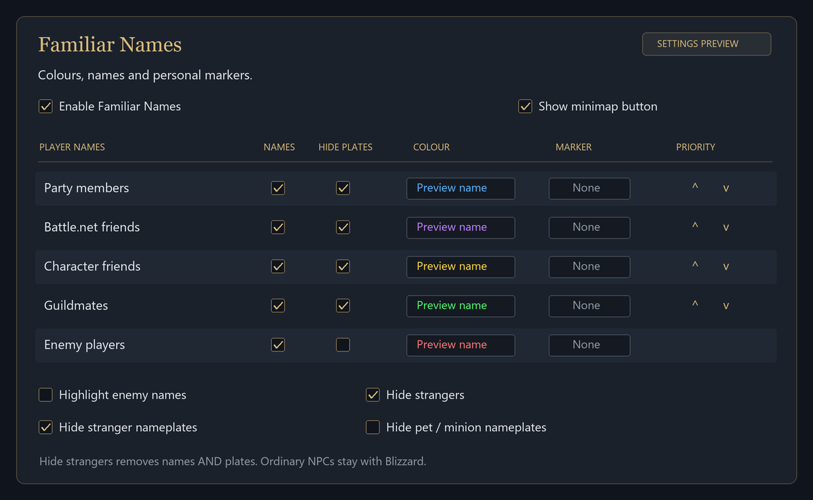
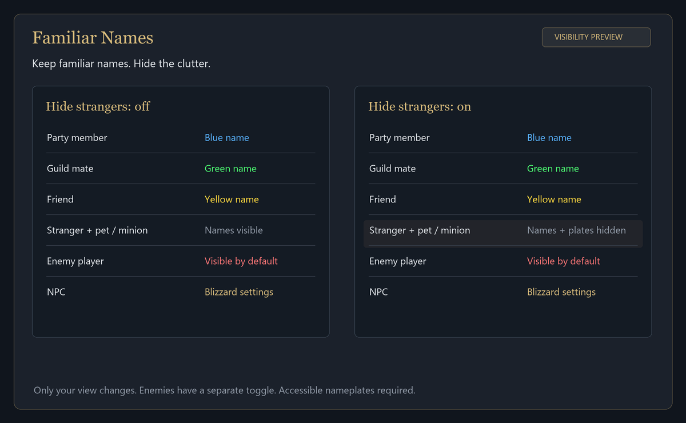

# Familiar Names

WoW Forever addon. Colour names for friends, Battle.net friends, guild mates and party members.

- Hide strangers and their pets / minions.
- Hide nameplates per category, while keeping coloured names.
- Enemy names visible by default, with optional highlighting.
- Personal markers only you can see.
- Blizzard-style settings, `/names` and a minimap button.

NPC names follow Blizzard settings. Open world only; nameplate limits apply.

*Illustrated previews.*
